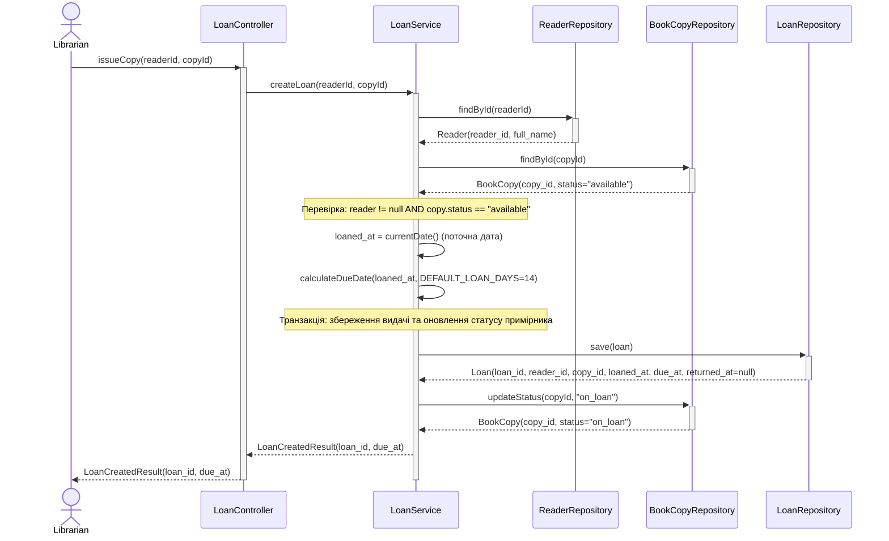
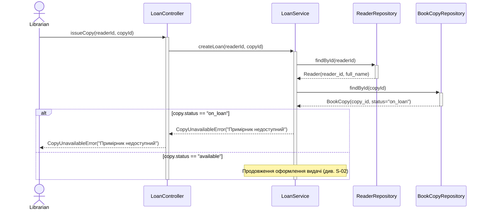
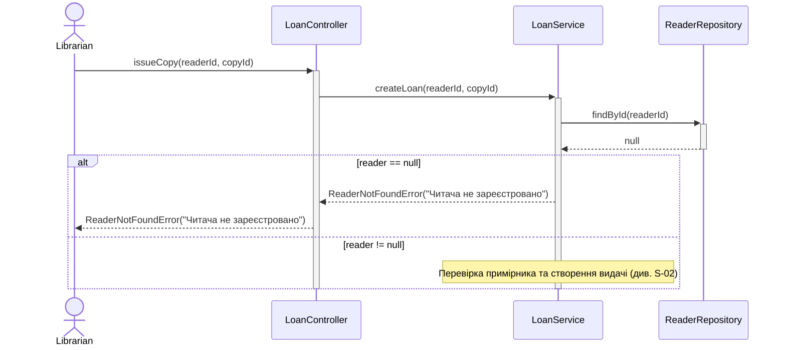

# Sequence-діаграми для UC-2 «Видати примірник»

## S-02: Успішна видача вільного примірника

## S-03: Відмова у видачі зайнятого примірника

## S-07: Відмова у видачі незареєстрованому читачеві

